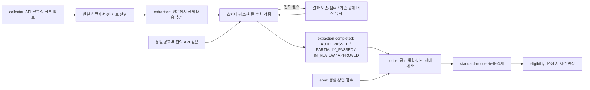

# 표준 공고 계약 v1

담당자 2의 **2-12 표준 공고 스키마** 구현본입니다. 기관·공고 분야·유형·지역 코드·일정·상태·단지/건물·호별 조건·자격 조건·근거·원문 링크를 포함합니다. 데이터 버전은 `1.0.0`, 이벤트 봉투 버전은 collector의 `raw.notice.collected`와 같은 정수 `1`입니다.

파일 작성과 로컬 계약 검증을 완료한 상태이며, **팀 전체가 이미 승인했다는 의미는 아닙니다.** 담당자 1·3·4와 변경 내용을 리뷰한 뒤 공유 계약으로 합의합니다. 기존 팀 합의는 유지하고, 새로 구체화한 코드·필드·이벤트 범위는 아래에 구분했습니다.

## 파일과 책임

| 파일 | 역할 | 작성/사용 주체 |
|---|---|---|
| `schemas/standard-notice.v1.json` | 서비스가 저장하고 조회하는 표준 공고(**논리 모델, 아직 만드는 코드 없음** — 2026-10-21 기준 notice는 `extraction.completed`의 `notice`를 버전별 스냅샷으로 저장하고, 목록·검색은 지역 5자리 색인과 원문 `supplyType`을 씀. 실제 응답 모양은 notice 모듈의 API 계약) | notice 모듈, 담당자 2 |
| `schemas/extracted-notice.v1.json` | 수집 원본에 연결된 추출 내용·불확실성·검증 결과 | extraction, 담당자 2 |
| `mappings/extraction-projection.v1.json` | 상세 자격 조건에서 판정용 조건으로 옮기는 필드 대응표 | Python 발행·검사 / Java 수신 |
| `schemas/eligibility.v1.json` | 적용 범위·조건식·예외를 보존하는 자격 조건 | extraction 작성, eligibility 판정, 담당자 4와 공유 |
| `schemas/notice-common.v1.json` | 가격·수량·일정·단지/건물·근거 등 공통 자료형 | 위 스키마가 `$ref`로 사용 |
| `schemas/eligibility-attributes.v1.json` | 지원하는 조건 속성 22개의 코드·단위·연산자·값 제약·benchmark 필수 여부 사전 | extraction / eligibility 공유. JSON Schema가 아닌 사전 데이터이며, 속성별 규칙의 유일한 기준 |
| `events/extraction.completed.v1.json` | 추출·자동 검증이 끝난 결과 이벤트(팀 이벤트 흐름 문서 확정 형식). 큐 `mujuthaek.extraction.completed` | extraction → api(notice) |
| `examples/` | 주거·상가·부분 실패·이벤트의 가상 예시 7개 | 계약 검토·회귀 검사 |
| `tools/validate_contracts.py`, `tests/` | JSON Schema 및 참조·정합성·완료 조건 검사 | 로컬 / CI |

모든 `$id`는 계약 식별자입니다. 해당 URL에 파일이 배포되어 있어야 한다는 뜻이 아닙니다. 검사기는 로컬 파일만 등록하고 네트워크로 `$ref`를 가져오지 않습니다.

## 전체 흐름



PDF 확보·API 호출·정정 원본 연결은 collector의 책임입니다. extraction은 전달받은 자료를 추출하고 검증합니다. `documents[].originalUrl`은 사용자에게 보여 줄 기관 원문 링크이며 추출기가 새로 다운로드해야 하는 작업 지시가 아닙니다. 내부 파일 경로·스토리지 키·서명 URL은 이 서비스 공고 계약에 넣지 않습니다.

이 계약은 논리적인 저장/조회 모델입니다. 전체 객체를 DB의 한 테이블에 저장하거나 모든 HTTP 응답에서 그대로 반환하도록 강제하지 않습니다. 목록 DTO는 요약 필드만 반환할 수 있고, 상세 DTO는 필요한 근거까지 제공합니다.

## 표준 공고 구조

다음은 필드 묶음을 설명하는 그림입니다. 실제 값·타입·필수 조건은 JSON Schema와 `examples/*.json`이 기준입니다.

```text
standard-notice
├─ schemaVersion / noticeId / noticeVersion
├─ previousNoticeVersion / changedFields / publicationState
├─ sourceReferences[]             수집 원본·버전·정정/후속 관계·게시 원문
├─ documents[]                    근거 문서 해시·원문 링크
├─ publisherCode / supplyTypeCode  서비스 필터용 기관·유형 코드
├─ regionScope / regionCodes[]    전국/지역/미확인·법정동코드 10자리
├─ applicationSummary             notice가 계산한 현재 접수 상태
├─ notice                         원문 공고 제목·기관명·분야·유형·공고일·대상군·수량·공고 전체 신청 방법(프로그램 계산)
├─ locations[]                    단지·건물·주소·지역 코드·상하위 관계
├─ supplyGroups[]                 주택형 / 개별 주택 / 사업공간 호실
│  ├─ locationId / unitLabel / floor / housingTypeCode / buildingUse
│  ├─ exclusiveAreaSqm / commonAreaSqm
│  ├─ counts[] / prices[]         모집 수·가격·부가세·가격안 연결
│  └─ leaseTerm                   최초·갱신·최대 임대 개월
├─ schedules[]                    종류·대상·순위·접수 방식·시작/종료·조건부 종료·신청 링크·접수 장소·이메일·접수 시각·제외 요일
├─ eligibility[]                  자격 조건·AND/OR/NOT·예외·원문
├─ selectionRules[]               순위·가점·동점·추첨·선착순·입찰
├─ requiredDocuments[]            제출 서류·대상·시점·서류 묶음·부수·발급 기관
├─ guidance[]                     신청 방법·놓치면 탈락하는 주의사항·입주 안내·생활 유의사항·문의처
├─ evidence[]                     문서·실제 페이지/문자 범위/행·원문 인용
├─ quality                        추출 범위·누락 사유·검토 이슈·필드 신뢰도·독립 검증
└─ areaSummaries[]                area가 계산한 공통 생활/상업 점수
```

| 필드 묶음 | 저장하는 내용과 사용 목적 |
|---|---|
| `notice.publisher`, `publisherCode` | 원문 기관명과 서비스 기관 코드를 구분합니다. 기관 코드 신규 등록은 프로그램/관리자가 처리합니다. |
| `notice.field` | `HOUSING` 또는 `BUSINESS_SPACE`입니다. 추출 중 미확인은 `null`, 완료 이벤트와 승인 공고에서는 실제 분야가 필요합니다. |
| `notice.supplyType`, `supplyTypeCode` | 원문 유형명과 정규화 코드를 구분합니다. 공공분양·국민임대·매입임대·상가임대 등을 필터링합니다. |
| `notice.targetGroups[]` | 청년 등 공고 내부 대상군입니다. 이 v1에서는 공고 내부 식별자로 해석하고, 자유로운 새 값을 전국 공통 코드로 간주하지 않습니다. |
| `regionCodes[]`, `locations[].regionCode` | 행정표준코드 **법정동코드 10자리 문자열**(시도 2 + 시군구 3 + 읍면동 3 + 리 2)입니다. 원문에서 확인한 단계까지만 쓰고 모르는 하위 단계는 0으로 채웁니다: 동까지 `1111010100`, 구까지 `1111000000`, 시도만 `1100000000`. 0 뒤에 다시 값이 올 수 없습니다(`REGION_CODE_HIERARCHY`). 같은 지역의 상하위는 앞부분이 같으므로, 위치 코드는 `regionCodes`의 같은 코드나 상위 코드로 찾을 수 있어야 합니다. 원문 동 이름이 행정동(예: 역삼1동)이라 법정동 하나로 정해지지 않으면 구 단위까지만 씁니다. collector의 5자리 시군구 코드는 뒤에 `00000`을 붙여 사용하고, 기관 자체 코드는 변환 후 사용합니다. 코드를 추정하지 않습니다. 원문 지역 표현은 `locations[].region`에 그대로 보존합니다. 지역 표현으로 시도까지만 정해지면 주소(`address`)로 시군구까지 다시 찾고(동만 적힌 주소는 그 시도에서 하나뿐인 법정동일 때만), 일반구가 있는 시는 주소의 구까지 내려갑니다. |
| 지역 코드 5자리(서비스 기준, 2026-10-20) | 서비스는 법정동코드 **앞 5자리(시도 2 + 시군구 3)**만 씁니다. 시군구 자리가 `000`이면 시도 단위입니다(`11000` = 서울특별시: 시도 전체이거나 시군구를 모름). **검색**: 시도 2자리나 시도 단위 5자리(`11`, `11000`)로 찾으면 그 시도의 모든 시군구 공고와 시도 단위 공고가 나오고, 시군구 5자리(`11680`)로 찾으면 그 시군구 공고만 나옵니다(시도 단위 공고는 나오지 않음 — 시군구를 몰라 시도 단위가 된 공고를 다른 구에 보여 주지 않기 위해). **전국 대상**: 위치의 원문 지역 표현이 「전국」이거나 「전국」 뒤에 띄어쓰기·괄호·「단위」가 이어지고(코드는 그렇게 시작하는지만 봄 — 위치의 지역 칸에서만 보므로 「전국 소재 주택」 같은 본문 문장과는 섞이지 않음) 지역 코드가 정해진 위치가 하나도 없으면 전국 대상 공고로 보고 어느 지역으로 검색해도 나옵니다(실측 근거: LH 전세임대 「2. 사업대상지역 : 전국」). 원문의 「전국」은 모집 지역이 아닌 경우가 많아(「전국 소재 주택」 무주택 판정, 「전국(국내)에 거주하는 … 에게 공급」 양산시 단지 매각의 신청 자격, 「전국 내역」 제출 서류), 특정 단지가 있는 공고는 신청 자격이 전국이어도 그 단지 지역 공고입니다. 위치가 없는 공고는 전국으로 보지 않습니다(실측: 주택 목록이 첨부에만 있는 「대구경북지역」「전북지역본부」 공고는 위치가 없지만 지역 공고). **대상 지역(`locations[].kind = AREA`)**: 단지·주소가 없는 공고(전세임대, 주택 목록이 별첨인 매입임대 등)는 공고의 대상 지역을 위치로 적습니다(「대구경북지역」 → 「대구」·「경북」 두 위치, 「사업대상지역 : 전국」 → 「전국」). AREA로 정한 시도·시는 그 아래 시군구 검색에도 나옵니다(대구 전체 → 대구 중구 검색). 정부 지원 정책(`policy.extracted`)도 같은 규칙을 쓰기로 제안합니다. |
| `regionScope` | `REGIONAL`은 코드가 1개 이상, `NATIONWIDE`는 코드 배열이 비어 있습니다. 판단하지 못하면 `UNKNOWN`입니다. |
| `sourceReferences[]` | `sourceCode`, 기관 공고 ID, `rawPostId`, `rawVersion`, 종류, `supersedesPostId`, 원문 제목·상태·게시일·상세 URL입니다. 원본 문자열을 보존합니다. 상세 URL은 collector가 받지 못하면 `null`이며 임의로 만들지 않습니다. |
| `documents[]` | 문서 ID·PDF/TEXT/UNITS/SPREADSHEET(엑셀 첨부)·이름·SHA-256·원문 URL·PDF 실제 페이지 수입니다. 엑셀 첨부(주택목록)는 extraction이 S3의 원본(`files[].s3Key`, `role` `UNIT_LIST`)을 직접 읽어 원문에 붙이고 공급표로 옮깁니다(collector의 `units`는 지방 공사 호별 표가 있을 때만 오고 LH는 빈 배열). URL을 못 받았으면 `null`, 게시 상세 URL은 `sourceReferences`에 유지합니다. |
| `locations[]` | `kind=COMPLEX/BUILDING/SITE/UNKNOWN`, 단지명·건물명·주소·코드를 저장합니다. 건물의 `parentLocationId`로 단지를 참조합니다. 독립 건물은 부모가 `null`입니다. |
| `supplyGroups[]` | `HOUSING_TYPE`, `HOUSING_UNIT`, `BUSINESS_UNIT`, `UNKNOWN`을 구분합니다. 호실명·층은 문자열로 지하층·복합 표기를 보존합니다. |
| `prices[]` | 보증금·월세·연세·분양가·최고분양가·계약금·잔금·입찰 예정가·입찰보증금·관리비입니다. 모든 정규 금액은 원화 정수 `amountKrw`이며 원문 값·단위도 보존합니다. |
| `allocationPoolId` (수량) | 선택 칸(2026-10-17). 여러 공급 묶음·계층이 원문 표의 한 칸(병합 칸) 모집 물량을 함께 쓰면 같은 ID. 같은 ID의 수량은 같은 `kind`·`value`여야 하고(`ALLOCATION_POOL_CONFLICT`) 합산하지 않습니다(대학생·청년 공유 21호를 42호로 세지 않음). |
| `priceStage` (가격) | 선택 칸(2026-10-17). `STANDARD` 기본, `CONVERSION_DEPOSIT_UP`/`DOWN` 보증금을 올리거나 내린 전환안, `BEFORE_SUPPORT` 지원 전(당초), `AFTER_SUPPORT` 지원 후(반값 등). 같은 `pricePlanId`는 같은 단계이며 단계끼리 더하지 않습니다. |
| `exclusiveAreaRange` / `amountRangeKrw` | 선택 칸. 원문이 면적·금액을 범위로만 적었을 때(「26~45㎡」「1,200만~1,500만원」) `{min, max}`로 적고 단일 값(`exclusiveAreaSqm`·`amountKrw`)은 `null`로 둡니다. 둘을 함께 쓰거나 min > max면 검사 오류입니다(`RANGE_WITH_SINGLE_VALUE`·`RANGE_REVERSED`). 범위로 적은 가격은 미확정 사유가 필요 없습니다. |
| `pricePlanId` | 같은 보증금/임대료 전환안의 가격들을 연결합니다. 서로 다른 전환안의 보증금과 월세를 섞어 계산하지 않습니다. 하나의 기본안만 있고 명시한 안 ID가 없으면 `null`을 사용할 수 있습니다. |
| `taxTreatment`, `vatRate`, `billingPeriod` | VAT 포함/별도/면세/해당 없음/미확인과 세율·일회/월/연 주기를 구분합니다. VAT를 일괄 10%로 채우지 않습니다. `MONTHLY_RENT`를 연 임대료로 해석하지 않습니다. |
| `counts[]` | 단지 전체 수·이번 모집 수·예비자·현재 공실·대기자를 구분합니다. 명시된 전체/구성 관계가 있을 때만 `parentCountId`, `aggregationComplete`로 합산 검증합니다. |
| `schedules[]` | 공고·신청·주택 열람(`VIEWING`: 주택 열람·세대 관람·샘플하우스·방문 예약)·서류 제출·서류심사 결과·당첨·계약·입주·입찰·개찰을 구분합니다. 같은 구간이 신청과 입찰을 겸하면 `kinds`에 둘 다 기록합니다. `applicationMode`로 기간제·상시·해당 없음·미확인을 구분합니다. |
| 일정 접수 방법·장소·시각(2026-10-23) | `channels`는 `ONLINE`(인터넷·온라인·홈페이지·모바일)·`ONSITE`(방문·현장·창구)·`EMAIL`·`MAIL`(우편·등기)·`FAX` 중에서만 고릅니다(이전 v1의 자유 글자에서 바뀜, 사용자 승인). 「인터넷 신청 불가」처럼 원문이 막은 방법은 넣지 않습니다. `places[]`(`name`·`address`·`detail`, 각 칸 글자 또는 `null`, 세 칸 모두 `null`이면 `EMPTY_PLACE`)는 방문 접수 장소, `applicationEmail`(`address`·`subjectFormat`)은 이메일 접수 주소입니다. 장소·주소·이메일은 원문에 그대로 있는 글자만 쓰고 근거에서 확인하지 못하면 `null`입니다. `dailyHours[]`·`breaks[]`는 접수하는 날의 시각 구간과 쉬는 시각(`{start, end}`, `HH:MM`, 한국 시각, `start < end` — `TIME_RANGE_REVERSED`), `excludedDays[]`는 접수하지 않는 요일·공휴일(`MON`…`SUN`, `HOLIDAY`), `timeNote`는 시각에 붙은 조건 설명입니다. 원문에 마감 시각(「18:00까지」)이 있으면 `startsAt`·`endsAt`을 `MINUTE`로 씁니다. 추출기는 시각·요일 낱말이 일정 근거 인용문에 있는지 확인하고, 없으면 그 칸을 비우고 표시 메모(`quality.notes`)를 남깁니다. **이전 저장본**: notice는 받는 이벤트만 계약으로 검사하고 저장된 이전 공고를 다시 검사하지 않습니다(새 칸이 없으면 빈 값, 자유 글자 `channels`는 정해진 값이 아니면 상세 응답에서 뺌). 추출기의 검수 승인은 저장된 이전 후보를 새 형식으로 옮긴 뒤(원문 낱말로 신청 방법을 정함) 검사합니다. |
| `notice.applicationChannels` | 공고 전체 신청 방법. AI가 쓰지 않고 프로그램이 신청(`APPLICATION`) 일정들의 `channels`를 합쳐 정해진 순서(`ONLINE`, `ONSITE`, `EMAIL`, `MAIL`, `FAX`)로 적습니다. 보류 여부와 상관없이 모든 신청 일정을 봅니다. 계산 값과 다르면 `APPLICATION_CHANNELS_CONFLICT`입니다. |
| `requiredDocuments[]` 묶음(2026-10-23) | `group`: `COMMON`(신청자 모두)·`CONDITIONAL`(해당자만)·`DIRECT`(본인 방문 신청)·`PROXY_SPOUSE`(배우자 대리)·`PROXY_OTHER`(배우자 외 대리)·`null`(원문이 묶음을 나누지 않음). `copies`는 근거 인용문에 「1부」「2통」처럼 있는 제출 부수, `issuer`는 근거에 그대로 있는 발급 기관이며 확인하지 못하면 `null`입니다. 같은 이름·같은 묶음·같은 제출 시점의 서류는 하나로 합칩니다(근거·대상 범위를 합침). |
| `scope` | 공고 전체 / 특정 단지·건물 / 특정 주택형·호실, 대상군·신규/재공급을 표현합니다. 가격·일정·수량·조건의 의미를 비교할 때 반드시 함께 확인합니다. |
| `selectionRules[]` | 선정 방식과 조건을 자격 필수 조건에서 분리합니다. 순위는 `priorityRank`, 가점은 `points/maxPoints`, 동점 순서는 `order`입니다. |
| `guidance[]` | 공고 상세 화면에 보여 줄 안내입니다(2026-10-16 추가). `kind`: `APPLICATION_METHOD`(신청 경로·우편 접수 주소와 대상·필요한 인증서), `CAUTION`(중복 신청 무효·자격 유지·서류 미제출 제외·계약 포기 시 지위 상실 등 놓치면 불이익), `MOVE_IN`(계약 후 입주 기한·대출 상환·열쇠 인도 등), `LIVING_NOTICE`(관리비·현 상태 입주·입주청소·전대 금지 등 거주 중 유의사항), `CONTACT`(문의처, 전화는 `phone`), `OTHER`. `title`은 짧은 제목, `description`은 원문을 요약한 문장, `url`은 원문에 적힌 링크만 씁니다. 판정 조건은 `eligibility`, 날짜가 있는 일정은 `schedules`에 두고 여기에 중복하지 않습니다. |
| `quality` | 자료가 실제로 없는 경우, 추출을 시도하지 않은 경우, 실패한 경우를 구분합니다. 상세 누락을 빈 배열만으로 숨기지 않습니다. |
| `areaSummaries[]` | 담당자 4의 area 결과만 반영합니다. `locationId`, 생활/상업 종류, 0~100 점수, 계산 시각·버전입니다. 사용자 개인 선호·직장·통근 점수는 넣지 않습니다. |

`supplyTypeCode`의 v1 코드 목록은 `standard-notice.v1.json`의 enum이 기준입니다. `OTHER`는 확인한 원문 유형이 기존 분류 밖인 경우, `UNKNOWN`은 아직 분류하지 못한 경우입니다. `publisherCode`는 기관 마스터와 연결할 안정적인 대문자 코드이며, 기관명을 AI가 임의로 축약해 생성하지 않습니다.

## 자격 조건과 선정 규칙

`eligibility[]`는 연령·국적·무주택·소득·자산·자동차·거주·혼인·자녀·청약저축·가구·사업자·업종·사업장 지역·업력 등을 담습니다. 조건 `value`에는 **공고의 기준값**을 저장합니다. 예를 들어 `AGE_YEARS >= 19`의 `19`이며 사용자의 실제 나이가 아닙니다.

```json
{
  "kind": "ALL",
  "children": [
    { "kind": "ATOMIC", "attribute": "AGE_YEARS", "operator": "GTE", "value": 19 },
    { "kind": "ATOMIC", "attribute": "AGE_YEARS", "operator": "LTE", "value": 39 }
  ]
}
```

위 코드는 논리 구조를 보여 주는 축약 예시입니다. `subject`, `unit`, `basis`, `referenceTime`, `benchmark`, `evidenceIds`까지 포함한 실행 가능한 전체 예시는 `examples/eligibility.json`에 있습니다.

- `ALL`은 AND, `ANY`는 OR, `NOT`은 부정입니다. 같은 조건의 대안은 `ANY` 안에 묶습니다. 별도 자격 항목은 해당 요청의 `scope`·대상에 적용되는 항목을 모두 만족해야 합니다.
- `subject`는 신청자/가구/부모/배우자/사업체/대표자 등을 구분합니다. `basis`, `referenceTime`으로 가구 범위·만 나이·공고일/신청일 등 산정 기준을 보존합니다.
- 소득 비율은 `INCOME_BENCHMARK_PERCENT`와 `benchmark`에 기준명·연도/버전·가구원 수·가구 범위를 기록합니다. 70%라는 숫자만으로 실제 소득 상한액을 계산하지 않습니다.
- 업종은 `INDUSTRY_CODE`와 `benchmark.standardName/referenceVersion`으로 KSIC 등 코드 체계를 명시합니다. 지역은 법정동코드 10자리로 정규화하며, 거주·사업장 지역 조건은 앞부분 비교로 판정합니다(조건 `1100000000`은 서울 안의 모든 하위 코드를 포함). 이 비교 규칙은 판정기(담당자 4)와 합의가 필요합니다.
- `exceptions[]`는 발동 조건 `when`과 `WAIVE/REPLACE/ADD_REQUIREMENT/OTHER` 효과를 보존합니다. 예외의 대체식은 기존 기준을 대체하며 기존 기준과 단순 AND로 합치지 않습니다.
- `ATOMIC` 스키마는 모양(속성 코드·연산자·값·단위 필드)과 연산자별 값 형태만 검사합니다. **속성별 단위·허용 연산자·값 타입·최솟값·코드 형식·값 목록·benchmark 필수 여부는 `eligibility-attributes.v1.json`이 기준**이며 `validate_contracts.py`가 `ATTRIBUTE_*`, `BENCHMARK_REQUIRED` 오류로 확인합니다. 이 계약을 읽는 다른 프로그램(예: 판정기)도 JSON Schema 검사만으로 끝내지 말고 같은 사전을 적용합니다. 속성을 추가·변경할 때는 사전만 고칩니다. 연산자 `EXISTS`는 스키마에 남아 있지만 v1 사전의 어떤 속성도 허용하지 않으므로 현재는 `ATTRIBUTE_OPERATOR_CONFLICT`가 됩니다.
- `STRUCTURED`는 v1 속성 사전으로 표현한 조건입니다. 표현할 수 없는 조건은 `UNSTRUCTURED`, `expression=null`, 사유와 원문으로 보존합니다. **미지원 조건·미확인 입력·미검토 예외의 판정은 `UNKNOWN`으로 처리합니다.** 이 계약에는 판정 엔진을 구현하지 않았습니다.
- `selectionRules`의 가점이나 입찰 방식을 지원 자격 탈락 조건으로 바꾸지 않습니다. 여러 예외가 동시에 적용되고 우선순위를 원문에서 확인할 수 없으면 검수합니다.

`description`은 존댓말 문장으로 작성합니다. 예: `외국인은 신청하실 수 없습니다.` `originalText`와 `quote`는 문체를 고치지 않고 원문 그대로 보존합니다.

## 시간·상태·근거

`startsAt/endsAt`은 날짜만 아는 `DAY`, 시각까지 아는 `MINUTE`, 월만 아는 `MONTH`를 구분합니다. 날짜만 있는 자료에 임의의 00시/23시를 추가하지 않습니다. 시각에는 `+09:00`이나 `Z` 등 시간대를 포함합니다. 날짜/월 비교 기준은 한국 시간입니다.

`endStatus=FIXED`는 종료값이 필요합니다. `CONDITIONAL`은 `별도 공지 시까지`, `소진 시까지`처럼 확인한 종료 조건을 기록하며 종료값은 `null`입니다. 정보가 없는 `NOT_IN_SOURCE/UNKNOWN`과 구분합니다.

`applicationSummary`는 notice가 기준 시각에 계산합니다. `UPCOMING/OPEN/CLOSED/ROLLING/UNKNOWN`, 시작·종료일, 사용한 신청 일정 ID, 계산 시각, 판단 사유를 보존합니다. 여러 접수 구간이 있으면 현재 접수 중인 구간, 다음 접수 구간, 종료된 구간을 함께 평가합니다. 단순 최소·최대 날짜만으로 그 사이를 모두 접수 중이라고 판단하지 않습니다.

상시/수시 모집은 원문에서 명시적으로 확인한 신청 일정의 `applicationMode=ROLLING`을 근거로 사용합니다. 상시 모집도 최종 접수 종료일이 함께 명시될 수 있으므로 `endStatus=FIXED`와 공존할 수 있습니다. **마감일이 없거나 조건부로 끝난다는 이유만으로 상시 모집으로 바꾸지 않습니다.** `공고중` 같은 게시 상태는 신청 접수 중과 다릅니다. 조기 소진·취소·중단은 해당 원문 상태/근거로 판단하며, `CLOSED`의 `closedReason`으로 종료 이유를 보존합니다. 이 저장 스키마가 상태 계산 스케줄러까지 구현한 것은 아닙니다.

근거의 `sourceId`는 `documents[].id`, `evidenceIds`는 `evidence[].id`를 참조합니다. 페이지는 PDF의 **실제 페이지 1부터** 세고, 인쇄된 페이지는 별도 `printedPage`에 넣습니다. 텍스트 범위는 Unicode 코드 포인트의 `[start,end)`이며 Java UTF-16 오프셋과 구분합니다. 표 행은 JSON Pointer로 가리킵니다.

`quality.reviewIssues`는 사람이 확인해야 하는 문제, `quality.notes`는 자동 처리하고 화면에 "원문 확인 필요"로만 보여 주는 문제입니다(2026-10-15 검수 등급). 판정에 쓰는 섹션(`notice`·`eligibility`)의 문제는 항상 `reviewIssues`이며, 그 밖의 섹션은 근거를 못 찾은 항목을 빼고(`PARTIAL`) `notes`에 남긴 채 완료할 수 있습니다. 값별 평가 기록(`fieldAssessments`)은 두지 않습니다(2026-10-15 제거). 모델 신뢰도는 쓰지 않으며, 값의 근거는 각 항목의 `evidenceIds`와 `evidence`로 확인합니다.

## API 원본 대조와 실패 처리

`quality.verification`은 AI 응답에서 받아 신뢰하는 필드가 아닙니다. 프로그램의 독립 검증기가 실제 파일 해시·페이지·인용문·표 합계·필드 의미를 확인한 뒤 작성합니다. 현재 계약 도구는 자료형·참조·정합성과 완료 조건을 검사하며 실제 PDF의 시각 검수/OCR/외부 API 호출은 수행하지 않습니다.

API 원본을 가지고 있다면 `apiComparison.referenceIdentity`의 원천·공고 ID·raw ID·버전이 같은지 먼저 확인합니다. `referenceSha256`은 보관한 원본 API 응답의 해시입니다. `fields[]`는 정규화 후 기대값·추출값·결과·원본 필드 경로를 남깁니다. 단지 전체 세대수와 이번 모집 수, 최고분양가와 호별 분양가, 게시 종료일과 접수 마감일처럼 의미가 다르면 `NOT_COMPARABLE`로 구분합니다.

API에 없는 소득/자산/예외 등 상세 조건은 API와 일치했다고 주장하지 않습니다. API가 없는 크롤링 공고는 `SKIPPED_NO_API_REFERENCE`로 기록하고 원문 기반 검증을 진행합니다. API의 기대값을 AI 입력에 넣거나 추출값에 복사한 결과를 독립 대조 성공으로 취급하지 않습니다.

| 상황 | 결과에 남길 내용 | 후속 동작 |
|---|---|---|
| 원문에 실제로 없음 | `null`/빈 배열 + `NOT_IN_SOURCE` 사유 | 다른 필드의 원문 검증을 계속합니다. 실제 금액 0과 구분합니다. |
| 항목 자체가 해당 없음 | `NOT_APPLICABLE` 사유 | 없는 조건을 필수 조건으로 만들지 않습니다. |
| 아직 추출하지 않음 / 일부 실패 | coverage `NOT_ATTEMPTED/PARTIAL/FAILED` + 누락 사유 | 부분 결과를 보존하고 `IN_REVIEW`로 발행합니다. `AUTO_PASSED`로는 발행하지 않습니다. |
| PDF 표/스캔을 해석하지 못함 | `SOURCE_ATTACHMENT_REQUIRED/EXTRACTION_FAILED/UNREADABLE` | 전달 자료/OCR/표 추출 보완 후 검수·재처리합니다. |
| 원문이 추후 통보·미정이라고 적음 | `TO_BE_ANNOUNCED`(2026-10-17) | 확인된 빈칸이라 완료를 막지 않습니다(`NOT_IN_SOURCE`와 같음). |
| 같은 범위에 서로 다른 값 | `CONFLICT`(2026-10-17) | 해소 근거가 없으면 검수(판정 섹션) 또는 표시. |
| 범위·합계·API 대조 충돌 | 검토 이슈 + 검증 `REVIEW_REQUIRED` | 같은 범위인지 확인하고 승인 전 공개 반영을 보류합니다. |
| 일시적인 API/AI/저장 오류 | 추출 job의 오류·시도 횟수에 기록 | job 정책에서 최대 시도 횟수와 지연을 두고 재시도합니다. 비용·재시도 상태는 이 공고 스키마에 넣지 않습니다. |
| 구버전 이벤트·중복 전달 | 원본 ID·버전과 이벤트 ID로 식별 | 소비자의 원자적 중복 방지·버전 검사를 적용합니다. 이 스키마만으로 멱등성이 구현되는 것은 아닙니다. |
| 정정공고 추출 실패 | 원본 연결·부분 결과·실패 사유 보존 | **기존 공개 버전을 유지**하고 수정 후보를 검수합니다. |

`extraction.completed`는 팀 이벤트 흐름 문서(2026-10-15)의 확정 형식입니다. 필수: `rawPostId`, `rawVersion`, `field`, `title`, `conditions`, `reviewStatus`. 선택: `provider`, `regionCode`(지역 5자리 = 법정동코드 앞 5자리. 위치의 앞 5자리가 하나면 그 코드, 같은 시도의 여러 시군구면 그 시도의 `xx000`, 여러 시도·코드 없는 위치·위치 없음이면 `null`), `schedule`(`applyStartOn`·`applyEndOn`), `applicationWindows`(알림용 접수 기간 목록: 순위·대상별로 기간이 따로면 하나씩 — `scheduleId`·`label`·`applyStartOn`·`applyEndOn`·`priorityRank`·`targetGroups`·`scopeDescription`, 2026-10-16 추가), `summary`, `reprocess`, `notice`(상세 화면용 표준 공고 전체).

- 검수 중이어도 발행합니다. `reviewStatus=AUTO_PASSED`는 독립 검증 `PASSED`, 미해결 이슈 없음, 추출 미완료 구간 없음, 모든 조건 `inReview=false`일 때만입니다. 그 밖은 `IN_REVIEW`입니다.
- `PARTIALLY_PASSED`(부분 완료, 2026-10-17): 검수 이슈가 특정 항목·섹션에만 있으면 공고는 게시하고 그 범위만 `heldItems`로 보류합니다(공고 수천 건을 다 사람이 보지 않기 위해, 검수 대기열에 넣지 않음). 보류한 자격 조건은 `inReview=true`이고 판정은 '원문 확인 필요'로 둡니다. 검수 이슈는 모두 보류 범위 안이어야 하며(`REVIEW_ISSUE_NOT_HELD`), 공고 정체성(`/notice`)·입력·원본 문서·API 불일치는 보류할 수 없어 `IN_REVIEW`입니다(`HELD_TARGET_NOT_ALLOWED`). 완료 조건은 보류 범위 밖에서만 검사합니다. 받는 쪽(api)은 공개하되 `heldItems`의 범위를 숨기거나 '확인 필요'로 표시합니다.
- `judgment`(2026-10-20): 판정 틀. 판정 담당이 정한 형식(`schemas/housing-judgment.v1.json`, `schemas/business-space-judgment.v1.json`, 받은 원본 그대로 — 고치지 않음)의 객체이며 분야가 `HOUSING`이면 주거 틀, `BUSINESS_SPACE`면 사업공간 틀입니다. extraction이 검증된 추출 결과에서 코드로 만들고(AI 호출 없음), 확신이 없는 조건은 틀의 `inReview`로 표시합니다. 틀이 없는 분야이거나 틀 검사를 통과하지 못하면 `null`(또는 칸 없음). 검사기는 분야와 틀(`EVENT_JUDGMENT_FIELD_CONFLICT`), 같은 공고·버전(`EVENT_JUDGMENT_IDENTITY_CONFLICT`), 스키마로 못 잡는 ID 유일성(`JUDGMENT_DUPLICATE_ID`)을 봅니다.
- `APPROVED`: 검수자가 확인·승인해 다시 보낸 결과입니다. 모든 조건은 `inReview=false`이며, 현재 차단용 `heldItems`는 해제합니다. 자동 검증 상태·시각·이슈는 유지하고, 보류를 포함한 원 후보는 검수 작업 기록에 보존합니다. 표준 공고를 만들 때 `reviewStatus=APPROVED`로 공개 근거를 명시하면 자동 기록이 `REVIEW_REQUIRED`여도 공개할 수 있습니다. 자동 결과를 `PASSED`로 바꾸지 않습니다.
- 상세 `notice`가 계약을 통과하지 못하면(오류 위치 격리 후에도) `notice` 없이 조건만 `IN_REVIEW`로 보냅니다. 이때 오류가 있던 조건은 조건식을 내려(`UNSTRUCTURED`) 자동 판정되지 않게 합니다.
- `conditions[]` 한 건 = `notice.eligibility[]` 한 건(같은 순서): ID뿐 아니라 대상(`target`)·대상군·분류·설명·원문·기준 시점·조건식·예외를 대조합니다. 새 발행본은 적용 단지·호별 `scope`도 포함합니다. 이전 v1에 `scope`가 없으면 Java 수신부가 상세에서 복원하며, 판정용 `NoticeCondition`에도 전달합니다. 검수 표시(`inReview`·`reviewReasons`)는 별도로 계산합니다.
- 검증을 통과하지 못했거나 공고 전체 범위가 아닌 접수 일정은 `schedule`에 넣지 않습니다(`null`).
- `NOT_IN_SOURCE/NOT_APPLICABLE`는 명시적으로 검토한 부재이므로 `AUTO_PASSED`를 막지 않습니다. 상세 조건이 미지원이면 그대로 표시하고 자격 판정은 `UNKNOWN`으로 유지할 수 있습니다.
- 바깥과 상세의 원본·버전·분야·제목·재처리 여부·조건 내용·지역·일정 투영을 대조합니다(`EVENT_*`). 주거·사업공간의 `AUTO_PASSED/PARTIALLY_PASSED/APPROVED`는 상세가 필수입니다. 다른 담당자의 `POLICY/STARTUP_SUPPORT`에는 주거 상세를 강제하지 않으며 notice는 해당 분야를 기록하고 건너뜁니다.

### 2026-10-20 구현 정합성 기준

- `schedule/applicationWindows`를 제공하면 상세에서 계산한 결과와 같아야 합니다. 생략한 이전 이벤트는 수신부가 상세에서 계산합니다. 일정 종류는 `APPLICATION`이며, 보류 대상이 일정의 상위·동일·하위 필드인 경우 모두 사용에서 제외합니다. 날짜 미정인 검증된 구간은 `null/null`로 보존합니다.
- Python 발행·검사는 동일한 변환 함수를 사용합니다. Java의 대응 함수는 `tests/fixtures/extraction-boundaries.json`의 공통 사례로 대조합니다. 변경 시 `python contracts/tools/build_boundary_cases.py`로 사례를 다시 만들고 두 언어의 검사를 실행합니다.
- Java 수신부는 클래스패스에 패키징한 저장소 스키마와 속성 사전을 재사용합니다. 외부 `$ref` 다운로드나 Python 프로세스 호출은 하지 않습니다. 형식·참조·수치·완료 조건은 수신 경계에서 검사하고, 원문 인용의 진위는 extraction이 확인합니다. 목록·상세 조회와 상태 재계산에서는 전체 스키마 검사를 반복하지 않습니다.
- `rawVersion`은 DB 정수 범위인 `1..2147483647`입니다. 스키마 오류 문자열은 입력 값을 포함하지 않고 코드·경로·키워드만 반환합니다. 정상 URL뿐 아니라 형식 오류·잘못된 타입에서도 인증 값이 오류에 복사되지 않아야 합니다.

## 정정·후속 공고와 버전

collector가 전달한 `kind=NOTICE/CORRECTION/FOLLOW_UP`, `rawPostId/rawVersion`, `supersedesPostId`를 그대로 보존합니다. collector가 연결한 원본 관계를 extraction이 제목 유사도만으로 다시 결정하지 않습니다. 연결이 필요한 정정/후속 공고에서 관계가 미확정이면 검수 상태로 보존합니다.

notice는 `supersedesPostId`를 이미 통합한 공고에 연결하고 새 `noticeVersion`을 만듭니다. 최초 버전은 1, `previousNoticeVersion=null`, `changedFields=[]`입니다. 이후 버전은 직전 버전과 실제 바뀐 JSON Pointer를 저장합니다. 삭제된 필드의 Pointer는 이전 저장 버전에서 해석합니다. `schemaVersion`은 계약 형식의 버전이며 공고 내용 버전과 다릅니다.

후속 공고는 당첨·계약 등의 일정/문서를 추가합니다. 기존 신청 일정을 빈 배열로 덮어쓰지 않습니다. 정정 문서의 부분 변경은 기존 원문·근거·변경 범위와 대조한 뒤 반영합니다. 이 병합 판단은 notice/extraction 구현의 책임이며, 스키마에 맞는다고 병합이 자동으로 정확해지는 것은 아닙니다.

공고 내 ID는 컬렉션에 걸쳐 유일하게 사용합니다. 예: 여러 호실의 가격 ID는 `201.deposit`, `202.deposit`처럼 구분합니다. 가격·수량·자격의 `scope`와 근거는 같은 공고 버전 안의 ID를 참조합니다.

## 기존 팀 계약과의 접점

확정된 요구사항: 주거·사업공간 공통화, 근거와 신뢰도, 정정 관계 적용, 상세 조건 추출, 코드·단위 정규화, 역할별 책임 분리입니다.

이번에 구체화한 v1 설계: 필드 이름/enum, 단지-건물 부모 참조, 가격안 ID, 재귀 조건식과 속성 22개, quality 보고서, `conditions` 한 건 구조와 상세 `notice` 선택 칸입니다. 이벤트 바깥 형식·봉투·큐는 팀 이벤트 흐름 문서(2026-10-15)를 따릅니다. 속성 코드와 기준표 해석은 담당자 4의 판정기와 함께 리뷰합니다.

입력 `raw.notice.collected`는 담당자 1(collector)이 소유합니다. 필수 칸은 스키마(`events/raw.notice.collected.v1.json`)가 기준이며 payload의 칸은 모두 필수입니다(없는 값은 null·빈 목록). `sourceCode`는 영문 소문자(예: `lh`, `sh`), `field`는 지금 `HOUSING`만 있습니다(사업공간 `BUSINESS_SPACE`는 수집 계약에 아직 없음 — 팀 합의 필요). 첨부 원본은 S3에 있고 이벤트에는 위치(`files[].s3Key`)만 담습니다. LH 등 API 응답 원본은 collector가 수집 DB(`meta._raw`)에만 보관하고 **이벤트로는 보내지 않습니다**.

**공고 입력 규칙(2026-10-16)**: 공고는 **PDF가 반드시** 오고, API JSON은 **있을 수도 없을 수도** 있습니다(모양은 API마다 다르고 PDF만큼 완전하지 않음).
- `files[]`의 `s3Key`·`role`(`NOTICE_DOC` 공고문, `UNIT_LIST` 주택목록)·`fileType`: extraction이 공고문 PDF를 S3에서 직접 읽어 쪽·표 구조로 바꿔 추출 원문으로 씁니다. 보관 기한이 지나 `s3Key`가 null이면 수집 글자(`text`)로 진행하고(`ATTACHMENT_NOT_STORED`), 공고문이 HWP뿐이면(`NOTICE_DOC_NOT_PDF`) 역시 수집 글자로 추출하되 사람 확인을 강제합니다. S3에서 첨부나 잘린 원문을 읽지 못했을 때만 `WAITING_SOURCE`로 기다렸다 다시 처리합니다.
- `apiData`(**아직 계약에 없음 — 선택 칸으로 추가하려면 담당자 1과 합의**, 지금은 보내면 스키마 위반이고 그래서 API 대조는 `SKIPPED_NO_API_REFERENCE`로 꺼져 있음): API 응답 JSON 그대로. 추출 원문이 아니라 **대조 기준**으로만 씁니다. 모양을 고정하지 않고 공통 대조표가 키 이름(`PAN_NT_ST_DT`·`rcritPblancDe`·`beginDe`·`sumSuplyCo` 등)으로 찾습니다. 아는 키가 없으면 "비교할 칸 없음"으로 두고 처리를 막지 않습니다. 공개 원문 URL을 내부 PDF 저장 위치로 간주하지 않습니다.

`field`는 POLICY·STARTUP_SUPPORT도 허용하지만, 이 경우의 `notice`·`conditions` 세부와 benefit 모듈의 수신은 담당자 3과 정합니다. 기존 Java `NoticePublished/Updated/Closed` 이벤트와 모듈 경계는 변경하지 않았습니다.

참고한 팀 문서: [역할 분담](https://app.notion.com/p/new-C-3f815a0120548010bcadfc00d200dc8f), [백엔드 진행 방식](https://app.notion.com/p/3f915a01205480328c9dc027f2010302), [컨벤션](https://app.notion.com/p/a0f15a01205483468e9b816b644e0669), [API 응답·정정공고 처리](https://app.notion.com/p/3f415a01205480818713c0ffc7bfd5d1). 미확정 서비스 기획은 확정 요구사항을 대체하는 근거로 사용하지 않았습니다.

## 검사 실행

저장소 루트에서 Python 3.12 이상으로 실행합니다.

```shell
python -m pip install -r contracts/requirements-dev.txt
python contracts/tools/validate_contracts.py
python -m unittest discover -s contracts/tests -p "test_*.py" -v
```

개별 파일 검사:

```shell
python contracts/tools/validate_contracts.py contracts/examples/housing.standard.json --schema schemas/standard-notice.v1.json
```

`.github/workflows/contracts.yml`에서 같은 검사를 실행합니다. JSON Schema Draft 2020-12, `FormatChecker`, RFC3339(date-time)·RFC3986(uri) 검사 의존성을 함께 사용합니다. 의존성이 없으면 jsonschema가 해당 형식을 조용히 건너뛰므로 `requirements-dev.txt`를 그대로 설치합니다. 같은 워크플로에서 `services/extraction` 어댑터 테스트도 실행해 어댑터 출력이 이 계약과 맞는지 확인합니다. 기존 파일을 사용하는 다른 프로그램도 형식 검사와 이 문서의 의미 검사를 함께 적용합니다.

예시의 기관·공고·식별자·`PASSED/APPROVED`·검증 시각은 전부 가상입니다. 실제 LH/SH 추출 성공이나 API 응답 일치를 뜻하지 않습니다. 예시 원문은 `examples/sources/`에 함께 두어 해시·인용문을 재현합니다. API 키 사용, 새 PDF 다운로드, 모델 호출은 검사 과정에 없습니다.

계약을 바꿀 때는 실제 신규 공고/실패 사례와 비교하고, 영향받는 프로그램의 소비자를 확인한 뒤 스키마·문서·예시·회귀 검사를 함께 갱신합니다. 필드 삭제·의미 변경·기존 코드 변경은 새 계약 버전으로 분리합니다. 검수에서 발견한 병합 표·수량 범위·페이지 오류를 회귀 사례로 추가합니다.

승인본도 제목·기관·분야·유형 등 공고 정체성은 필수입니다. 사람의 승인은 자동 검증 이력을 보존하는 공개 근거이며, 필수 정체성 누락을 허용하는 우회 수단은 아닙니다.
